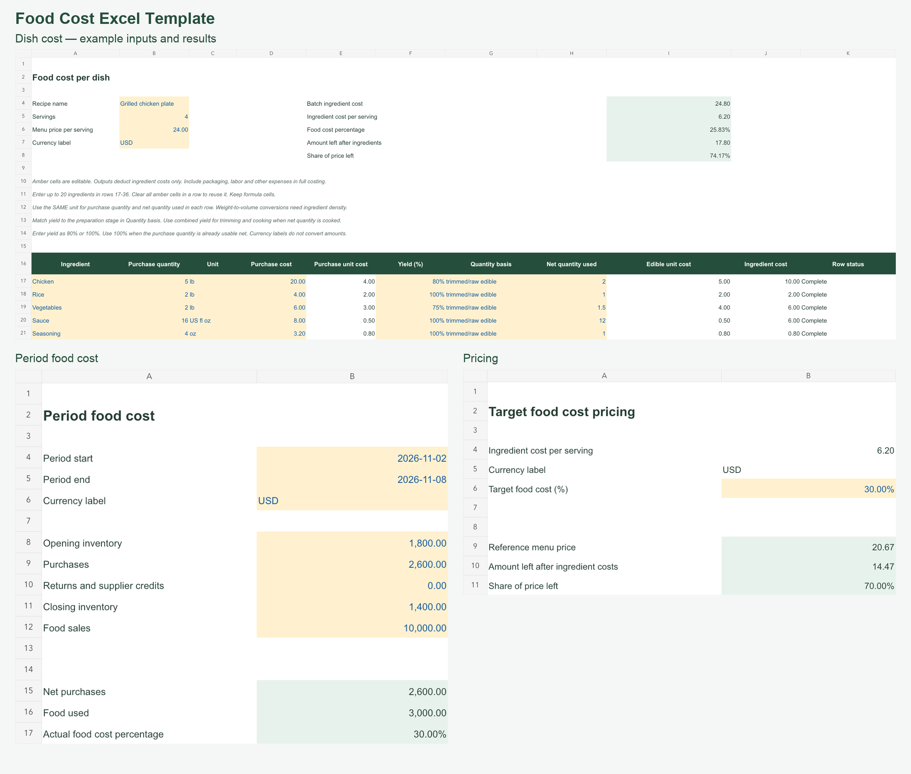

# Food Cost Excel Template

A free food cost formula template by MyRecipeCost for calculating dish costs, period food costs and target menu prices.

[Download the free food cost formula template](https://github.com/KopLyf/food-cost-excel-template/raw/refs/heads/main/food-cost-formula-template.xlsx)

## What's inside

Three worksheets:

- **Dish cost** — ingredient cost per dish from up to 20 ingredients (rows 17–36), including purchase quantities, purchase costs, yield and net quantities used.
- **Period food cost** — (opening inventory + net purchases − closing inventory) ÷ food sales. Net purchases deduct returns and supplier credits.
- **Pricing** — ingredient cost per serving ÷ your target food cost percentage, giving a reference menu price.

The example uses US dollars. Changing a currency label does not convert amounts. Use one currency consistently for all amounts in a calculation.

## How to use it

1. Open the workbook in Excel.
2. On **Dish cost**, enter your recipe name in **B4**, number of servings in **B5**, menu price per serving in **B6** and currency label in **B7**.
3. Enter ingredients in **rows 17–36, columns A–D and F–H**. These input cells are also highlighted in amber. Keep the header row (**16**) and formula columns **E, I, J and K** unchanged. To remove an example ingredient, clear all its input cells while keeping the formulas.
4. Use the same unit for purchase quantity and net quantity used in each ingredient row. Match the yield to the preparation stage entered under **Quantity basis**. Use **100%** yield when the purchase quantity is already usable net.
5. Enter your actual yield in **Dish cost F17:F36**. For clarity, type a percentage with its **%** sign, such as **80%**. This is an example, not a recommended yield for every ingredient.
6. On **Pricing**, set your own target food cost percentage in **B6**. **30%** is only an example. Ingredient cost per serving and the currency label are linked from **Dish cost**.
7. To calculate period food cost, separately fill in **Period food cost B4:B6** (dates and currency) and **B8:B12** (opening inventory, purchases, returns and supplier credits, closing inventory and food sales). Match the dates and food categories. Food sales should exclude refunds, discounts and collected sales tax. Keep the formula outputs unchanged.

## What this workbook does not do

- It does not connect to a POS system, accounting software or live supplier prices.
- It calculates ingredient costs and food cost percentages. It does not calculate a complete business profit after packaging, labor, rent, utilities and taxes. The amount left after ingredient costs is not net profit.
- It does not convert currencies or units automatically.

## License

The workbook, preview image and README are released under **CC0 1.0 Universal** (public domain dedication): free to use, modify and share, with no attribution required. See the **LICENSE** file for the full terms. This dedication applies to the files in this repository, not to the linked website or its other materials.

[Read the formula guide and get the printable cheat sheet](https://myrecipecost.com/food-cost-formula)
